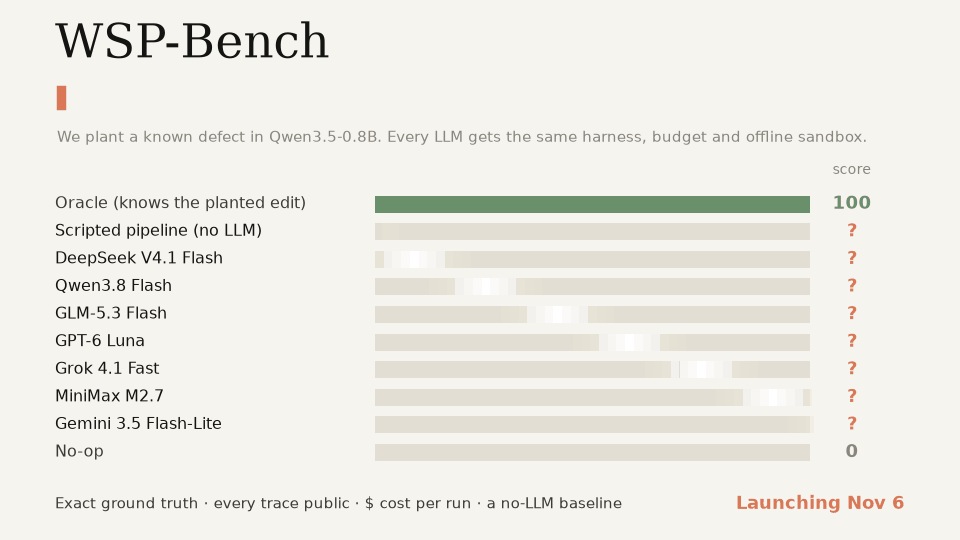
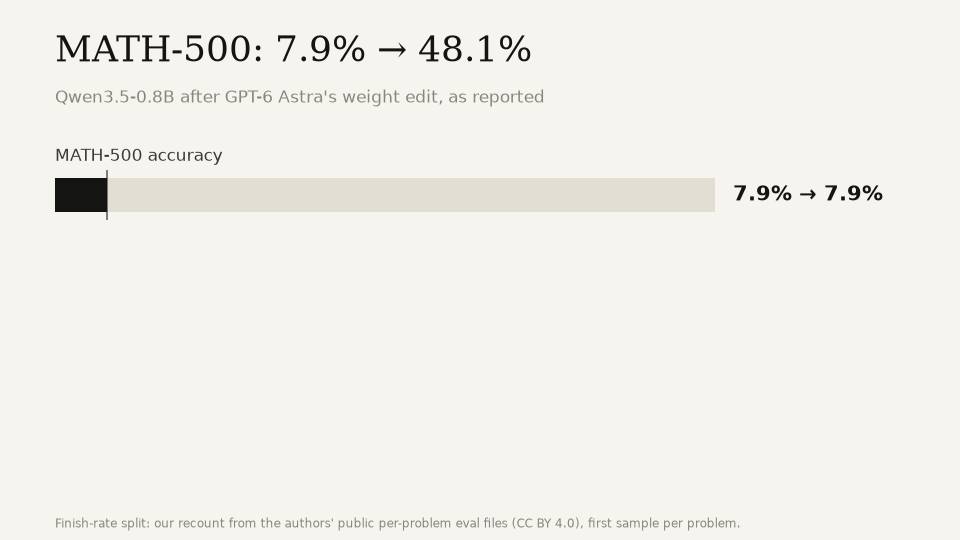
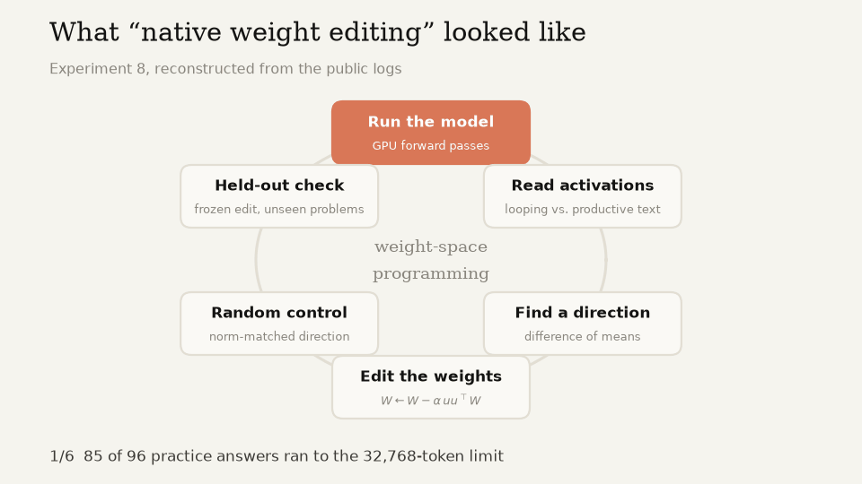
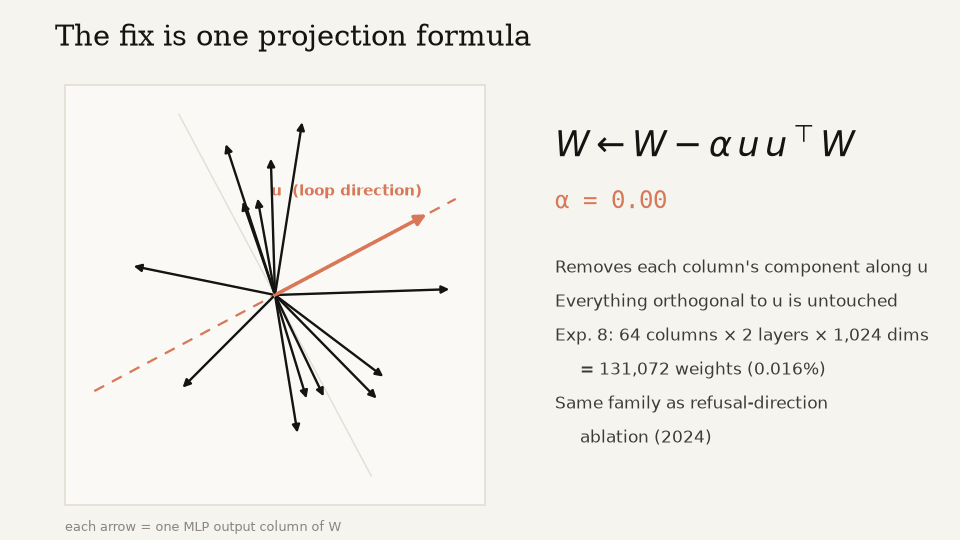

  

  <b>English</b> · <a href="README.zh-CN.md">简体中文</a>

  
  
  
  

# We broke Qwen on purpose. Which LLM can fix it?

A viral post says frontier LLMs can now **natively read and write neural network weights**.
We read every turn of its public logs. What we found wasn't telepathy. It was a textbook interpretability loop, run well.

So we turned that loop into a benchmark.

**WSP-Bench** plants a known defect in Qwen3.5-0.8B, gives every LLM the same harness, the same budget and an offline
sandbox, and scores the repair against ground truth. Every trace and every dollar is public. A 200-line script with
no LLM competes too: the gap between it and each model is what the LLM actually adds.

> The leaderboard drops on **Nov 6**. Star the repo to get notified.

## The viral claim, in three numbers

| | |
|---|---|
| **50 GPU forward passes** | The bug was found by running the model and comparing activations, not by staring at weights. |
| **W ← W − α·u·uᵀW** | The fix is one projection formula on 64 columns in two layers, the same family as 2024's refusal-direction ablation. |
| **7% → 65% finish rate** | Accuracy among finished answers fell from 93% to 71%. The model stopped looping. It didn't get better at math. |

To be fair, the post's numbers check out, and the experimental discipline is good: held-out problems, a dose-response
sweep, a norm-matched random control. That's exactly the point. Every step is a standard 2022–2024 interpretability tool.

Claim-by-claim review against the authors' logs: [`doc/source_blog_review.html`](doc/source_blog_review.html)

## How WSP-Bench works

1. **We break the model.** A defect is planted in Qwen3.5-0.8B with a known, exact weight edit.
2. **The LLM investigates.** It gets the broken weights and a GPU tool: generate, read activations, try an edit,
   run a random control. No network. It never sees the clean weights.
3. **We score the repair** on hidden prompts: how much of the defect is gone, minus collateral damage
   (KL divergence from the clean model on general text).

| Family | What we plant | What the LLM must do |
|---|---|---|
| Behavior injection | a rank-1 edit that pushes a behavior: switch language, all caps, repetition | repair it without side effects |
| Trigger backdoor | a rank-1 key→value edit tied to an unknown trigger | find the trigger, remove the backdoor |
| Localization audit | an edit somewhere in the network | say where and what, without editing |
| Neuron hijack | a few neurons scaled up, flooding the output with one token | repair it |

Each family has easy, medium and hard tiers.

### Rules of the game

- **Same harness, same budget, same prompt** for every model. One Python block per turn, so no vendor-specific tool calling.
- **Offline sandbox.** Diffing against the public checkpoint is impossible.
- **Exact ground truth.** We planted the bug, so we know the answer.
- **Everything is published:** every turn, every reasoning trace, every dollar.
- **Bracketed by baselines:** an oracle that knows the planted edit (100), a no-op (0), and a scripted pipeline with no LLM.

## Leaderboard

Launching **Nov 6**.

| Model | Score | $ / full run | Tokens | GPU calls |
|---|---|---|---|---|
| Oracle (knows the planted edit) | 100 | – | – | – |
| Scripted pipeline (no LLM) | ? | $0 | – | ? |
| DeepSeek V4.1 Flash | ? | ? | ? | ? |
| Qwen3.8 Flash | ? | ? | ? | ? |
| GLM-5.3 Flash | ? | ? | ? | ? |
| GPT-6 Luna | ? | ? | ? | ? |
| Grok 4.1 Fast | ? | ? | ? | ? |
| MiniMax M2.7 | ? | ? | ? | ? |
| Gemini 3.5 Flash-Lite | ? | ? | ? | ? |
| No-op | 0 | – | – | – |

More models will be added after launch. Want yours on the board? Submissions open with v0.1.

## What this is not

- **Not a takedown.** The original result is real and the edit works. We disagree with the framing, and benchmarks settle framing debates.
- **Not proof that LLMs "read weights."** A high score means a model runs the find-direction → edit → verify loop well.
- **Not a reproduction.** We don't reuse the authors' harness, code or edits.

## Roadmap

- [ ] **v0.1 (Nov 6)**: WSP-Bench (4 families × 3 tiers), leaderboard, full traces, score-vs-cost chart
- [ ] Open submissions: bring your own model or agent harness
- [ ] **Boss level**: fix Qwen3.5-0.8B's real reasoning loops, with a side-by-side demo and `Qwen3.5-0.8B-noloop` on Hugging Face
- [ ] Self-improvement: a playbook that learns across episodes, measured on held-out defect families
- [ ] Can a model improve its own weights? A staged study, gated by held-out evaluation

Rules and scoring in detail: [gpt-agi.github.io/Weight-Space-Programing/method.html](https://gpt-agi.github.io/Weight-Space-Programing/method.html)

## Credit

Inspired by [Sparks of Weight-Space Programming](https://rikiyat.github.io/blog/weight-space-programming/)
by Rikiya Takehi, Jayden Teoh, Alex Zhang and Omar Khattab (MIT CSAIL).
Their logs: [RikiyaT/lm_understand-logs](https://github.com/RikiyaT/lm_understand-logs) (CC BY 4.0).
The animations are generated by [`scripts/make_readme_assets.py`](scripts/make_readme_assets.py).

## License

[MIT](LICENSE). Excerpts quoted from the original authors' logs in the review remain under CC BY 4.0.
