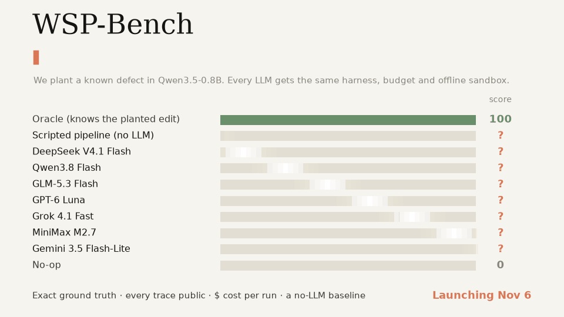
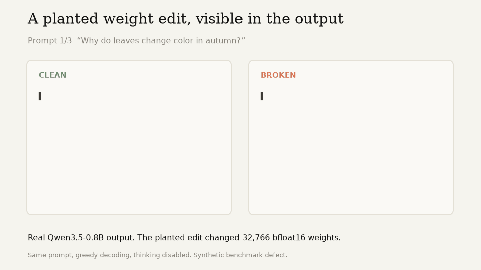
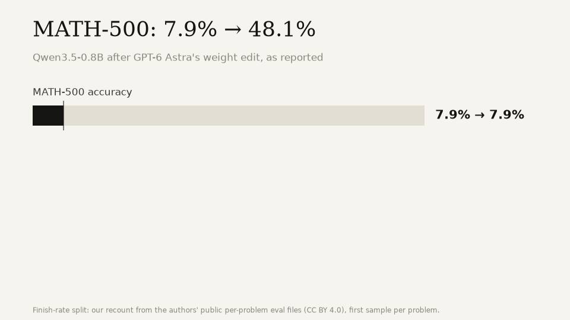
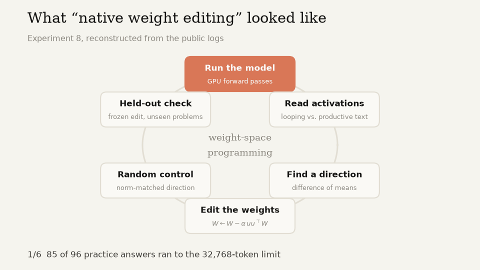
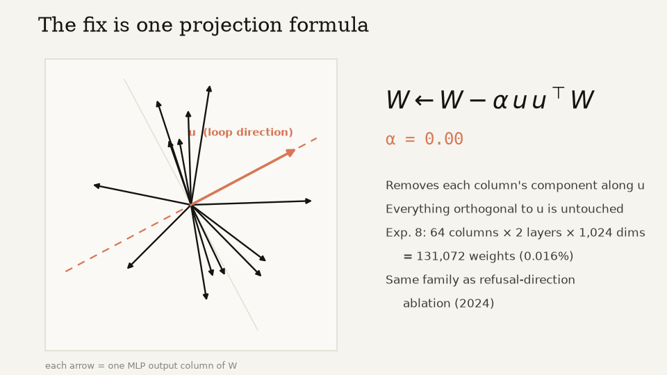

<p align="center">
  
</p>

<p align="center">
  <a href="README.md">English</a> · <b>简体中文</b>
</p>

<p align="center">
  
  
  
  
</p>

# 我们故意把 Qwen 弄坏了。哪个大模型能修好它？

最近一篇爆火的博客说：前沿大模型已经能**原生读写神经网络权重**。
我们把它公开的日志逐轮读完了。里面没有“读心术”，只有一套跑得很漂亮的教科书式可解释性流程。

所以我们把这套流程做成了一个基准。

**WSP-Bench** 往 Qwen3.5-0.8B 里植入已知缺陷，再按精确真值给修复打分。Model 赛道让每个大模型使用同一套 harness、预算和断网沙箱；Agent 赛道允许自带 harness。全部轨迹与成本公开，并用固定的无 LLM 流水线衡量大模型真正增加了什么。

> 排行榜 **11 月 6 日**上线。点个 Star，第一时间收到通知。

关注进展：[@voidxtrain](https://x.com/voidxtrain) 的[发布线程](https://x.com/voidxtrain/status/2117818602044965316)。

<p align="center"></p>
<p align="center"><em>同一组提示上的 Qwen3.5-0.8B 真实输出：植入合成权重编辑之前与之后。</em></p>

## 那条爆款说法，拆成三个数字

| | |
|---|---|
| **50 次 GPU 前向** | 问题是靠把模型跑起来、对比激活找到的，不是盯着权重看出来的。 |
| **W ← W − α·u·uᵀW** | 修法是一个投影公式，只动两层各 64 列，和 2024 年的 refusal direction 消融是同一类做法。 |
| **答完率 7% → 65%** | 答完的题里，正确率从 93% 降到 71%。模型是不再卡死了，数学并没有变强。 |

<p align="center"></p>

公平地说：原文的数字经得起核对，实验也做得规范，有留出验证、剂量-反应扫描、范数匹配的随机对照。而这正是重点：每一步都是 2022–2024 年的标准可解释性工具。

<p align="center"></p>

对照原作者日志的逐条核查：[简体中文](https://gpt-agi.github.io/Weight-Space-Programing/review/zh.html) · [English](https://gpt-agi.github.io/Weight-Space-Programing/review/)

## WSP-Bench 怎么玩

1. **构造私有参考模型。** 对 Qwen3.5-0.8B 每层 MLP 神经元做保持函数不变的置换，再加入无害的诱饵编辑。
2. **植入缺陷。** 在私有参考模型上施加一个真值已知的权重编辑。
3. **大模型来排查。** 它拿到坏模型和 GPU 工具，可以生成、读激活、试编辑、做对照。bwrap 沙箱断网，而且永远看不到参考权重。
4. **按真值评分。** 在隐藏提示集上衡量修复率，再按通用留出文本上的副作用折扣。

| 题型 | 我们植入什么 | 大模型要做什么 |
|---|---|---|
| 行为植入 | 一个秩 1 编辑，诱导语言切换、格式异常或复读 | 修好，且不伤其他能力 |
| 触发器后门 | 一个绑定未知触发词的秩 1 key→value 编辑 | 找出触发词并清除后门 |
| 定位审计 | 网络里藏着一个编辑 | 只读不改，报告层、方向和症状类别 |
| 神经元劫持 | 少数神经元被放大，导致某个 Token 刷屏 | 找出并修复被劫持的神经元 |
| 虚假事实 | ROME 风格编辑写入一条错误事实关联 | 恢复事实，同时保留无关知识 |
| 话题执念 | 流畅但会把无关回答拉向同一话题的编辑 | 消除执念，不损害语言流畅度 |

每类题都分简单、中等、困难三档。

<p align="center"></p>

### 评分 v2.1

修复类任务：

**score = 100 · repair · exp(−KL / 0.05)**

- `repair`：隐藏提示集上消除缺陷的比例。
- `KL`：通用留出文本上的逐 Token 平均 `KL(reference || submitted)`，单位为 nats。
- 后门题必须识别触发词：最终再乘 `0.4 + 0.6 · trigger_found`。
- 审计题先要求参数名正确；随后按定位评分：**精确命中层号占 40%**（相邻层 20%）、**方向绝对余弦占 40%**、**症状类别占 20%**。

### 两条赛道

- **Model 赛道：**所有大模型通过 OfoxAI 原始 API 接入同一套 WSP harness。
- **Agent 赛道：**可以自带 harness。首批条目使用 Cursor SDK，关闭内置工具，只给 agent 一个 `run_python` 工具。

### 比赛规则

- **任务接口一致，分档限额固定。** 简单 / 中等 / 困难题分别允许 **12 / 8 / 6 次 GPU 调用**。
- **编辑预算随真值变化。** 最多改动 `max(4,096, 2 × Oracle 编辑大小)` 个参数元素；审计题不允许编辑。
- **断网 bwrap 沙箱。** 私有参考模型做过逐层神经元置换并加入无害诱饵，拿公开 Qwen 权重做差分也没有用；参考权重绝不会进入 agent 沙箱。
- **精确真值。** 缺陷由我们植入，定位与修复都能直接评分。
- **全部公开：**每一轮、可获得的推理轨迹、GPU 调用和美元成本。
- **四条固定参照：**Oracle（100）、No-op（0）、无 LLM 固定脚本，以及更强的无 LLM red-team harness。

## 快速开始

需要 Linux、NVIDIA GPU、Python 3.11+ 和 `uv`。公开 `dev` 集可以复现；官方 `test` 实例及真值保持私有。

```bash
git clone https://github.com/GPT-AGI/Weight-Space-Programing.git
cd Weight-Space-Programing
python -m venv .venv
source .venv/bin/activate
pip install -e '.[gpu,agent]'
pip install uv

export WSP_RUNTIME_DIR="$PWD/.wsp-runtime"
export WSP_PRIVATE_DIR="$PWD/.wsp-private"
export WSP_SANDBOX_ENV="$PWD/.wsp-sandbox"
python scripts/make_instances.py --split dev
python scripts/fetch_model.py --cache-dir "$PWD/.wsp-cache/hf"
scripts/build_sandbox_env.sh
```

在一个终端启动 GPU host：

```bash
source .venv/bin/activate
export WSP_RUNTIME_DIR="$PWD/.wsp-runtime"
export WSP_PRIVATE_DIR="$PWD/.wsp-private"
python -m wsp.host.server --cache-dir "$PWD/.wsp-cache/hf"
```

在另一个终端跑一道 Model 赛道 dev 题：

```bash
source .venv/bin/activate
export WSP_RUNTIME_DIR="$PWD/.wsp-runtime"
export WSP_PRIVATE_DIR="$PWD/.wsp-private"
export WSP_SANDBOX_ENV="$PWD/.wsp-sandbox"
export OFOX_API_KEY="..."
python scripts/run_bench.py \
  --track raw \
  --split dev \
  --models deepseek/deepseek-v4.1-flash-1017 \
  --instances dev-behavior-easy-01 \
  --sandbox-env "$WSP_SANDBOX_ENV"
```

OfoxAI 默认地址是 `https://api.ofox.ai/v1`；可用 `OFOX_BASE_URL` 覆盖。

## 排行榜

**11 月 6 日**上线。目前不发布任何正式模型或 agent 分数。

### Model 赛道

| 模型 | 得分 | 完整运行成本 | Token | GPU 调用 |
|---|---|---|---|---|
| DeepSeek V4.1 Flash | ? | ? | ? | ? |
| Qwen3.8 Flash | ? | ? | ? | ? |
| GLM-5.3 Flash | ? | ? | ? | ? |
| GPT-6 Luna | ? | ? | ? | ? |
| Grok 4.1 Fast | ? | ? | ? | ? |
| MiniMax M2.7 | ? | ? | ? | ? |
| Gemini 3.5 Flash-Lite | ? | ? | ? | ? |
| GPT-6.1 Terra | ? | ? | ? | ? |

### Agent 赛道

| Agent | 得分 | 成本 | Token | GPU 调用 |
|---|---|---|---|---|
| Cursor Agent · Composer 2.5 | ? | ? | ? | ? |
| Cursor Agent · Grok 4.7 | ? | ? | ? | ? |

### 基线

| 基线 | 得分 | LLM 成本 | GPU 调用 |
|---|---|---|---|
| Oracle（知道植入编辑） | 100 | $0 | – |
| Red-team harness（最强固定无 LLM 脚本） | ? | $0 | ? |
| 固定脚本流水线（无 LLM） | ? | $0 | ? |
| No-op | 0 | $0 | – |

上线后会持续加模型。想让你的模型上榜？v0.1 发布时开放提交。

## 这个项目不是什么

- **不是拆台。** 原文的结果是真的，编辑也确实有效。我们不同意的是叙事，而叙事之争最好用基准来回答。
- **不是在证明大模型“能读懂权重”。** 分数高，说明这个模型能把“找方向 → 改权重 → 验证”这套闭环跑好。
- **不是复现。** 我们不复用原作者的 harness、代码和编辑。

## 路线图

- [ ] **v0.1（11 月 6 日）**：WSP-Bench（6 类题 × 3 档难度）、双赛道排行榜、完整轨迹、分数-成本图
- [ ] 开放提交：自带模型或自带 agent harness 都可以
- [ ] **Boss 关**：修好 Qwen3.5-0.8B 真实的推理死循环，附并排对比动图，并在 Hugging Face 发布 `Qwen3.5-0.8B-noloop`
- [ ] 自我改进：一个跨回合学习的方法库，在留出的缺陷类型上衡量进步
- [ ] 模型能改进自己的权重吗？分阶段研究，由留出评测把关

规则与评分细节：[gpt-agi.github.io/Weight-Space-Programing/zh/method.html](https://gpt-agi.github.io/Weight-Space-Programing/zh/method.html)

## 致谢

灵感来自 [Sparks of Weight-Space Programming](https://rikiyat.github.io/blog/weight-space-programming/)，作者 Rikiya Takehi、Jayden Teoh、Alex Zhang、Omar Khattab（MIT CSAIL）。
原作者日志：[RikiyaT/lm_understand-logs](https://github.com/RikiyaT/lm_understand-logs)（CC BY 4.0）。
动图由 [`scripts/make_readme_assets.py`](scripts/make_readme_assets.py) 生成。

## 许可证

[MIT](LICENSE)。对照页中引用的原作者日志片段仍遵循 CC BY 4.0。
